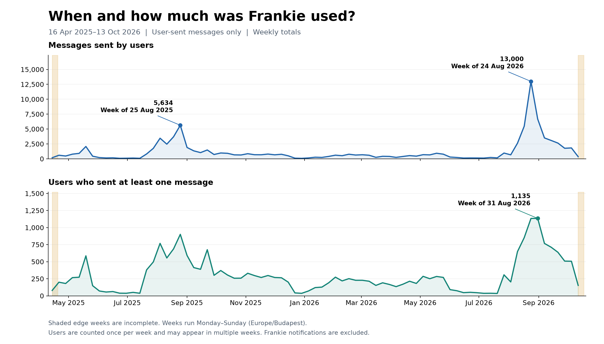

### When was Frankie used most?

| What stands out | When | Numbers |
| --- | --- | --- |
| Most user messages in one complete week | 2026-08-24 to 2026-08-30 | **13,000 messages**, 1,134 users |
| Most users in one complete week | 2026-08-31 to 2026-09-06 | **1,135 users**, 6,670 messages |
| Largest weekly increase in message count | 2026-08-24 to 2026-08-30 | 5,477 → 13,000: **+7,523 (+137.4%)** |
| Largest weekly decrease in message count | 2026-08-31 to 2026-09-06 | 13,000 → 6,670: **-6,330 (-48.7%)** |
| Highest-volume week in 2025 | 2025-08-25 to 2025-08-31 | 5,634 messages; 901 users |
| Leading automatically grouped topics during the 2026 message peak | 2026-08-24 to 2026-08-30 | Other / context-dependent text: 2,284; Events / clubs / networking: 1,211; Opening Week / onboarding: 483. Counts are grouped requests, not messages; they show the topic mix, not the cause of the increase. |
| Coverage | 16 April 2025–13 October 2026 | First and last weeks are incomplete and excluded from peak/change comparisons. No data for 14 October. [Weekly counts](weekly-activity.csv) · [Monthly counts](monthly-activity.csv) |
